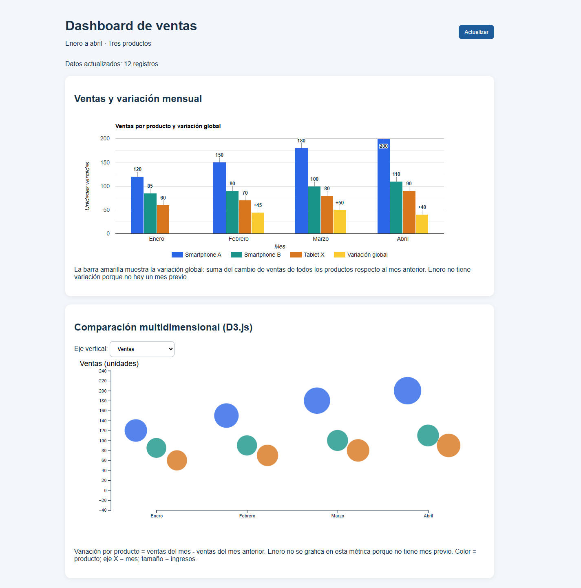
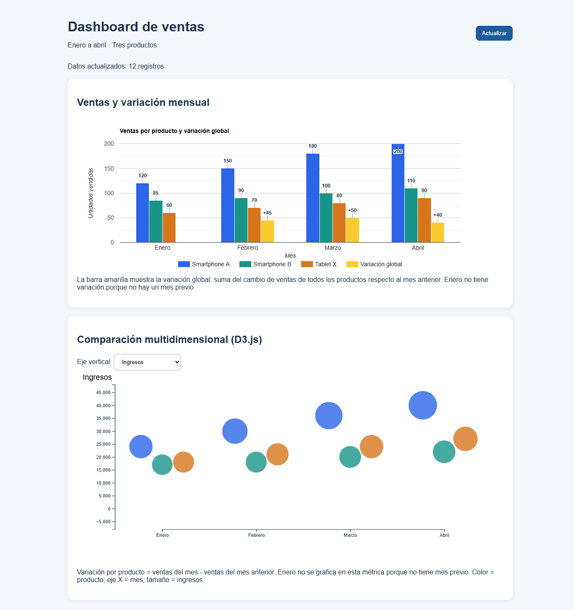

# Dashboard Ventas

Aplicación web personal para visualizar y comparar las ventas de tres productos
durante enero, febrero, marzo y abril. Incluye gráficos interactivos basados en
Google Charts y D3.js, y carga los datos de ejemplo desde un archivo JSON.

**Repositorio:** [Mijarex/Dashboard-ventas-D3.JS](https://github.com/Mijarex/Dashboard-ventas-D3.JS)

## Funcionalidades

- Compara las unidades vendidas de cada producto en un gráfico de columnas.
- Muestra en amarillo la variación global de ventas frente al mes anterior,
  con etiquetas en las barras.
- Explora las ventas e ingresos mensuales mediante un gráfico de burbujas.
- Cambia la métrica del eje vertical entre unidades vendidas e ingresos.
- Consulta el detalle de un registro al pasar el puntero sobre su burbuja.
- Selecciona una burbuja para mostrar un resumen y vuelve a cargar los datos
  con el botón **Actualizar**.
- Se adapta a pantallas pequeñas.

## Capturas del dashboard en ejecución

Resultados obtenidos al ejecutar la aplicación en `http://localhost:3001` con
los doce registros incluidos en `Public/ventas.json`. Las capturas muestran
enero a abril y las etiquetas de ventas y variación global.

**Ventas como métrica vertical**



**Ingresos como métrica vertical**



## Tecnologías

- **Node.js y Express:** servidor local de la aplicación.
- **HTML y CSS:** estructura y presentación adaptable.
- **Google Charts:** gráfico de columnas.
- **D3.js:** gráfico interactivo de burbujas.

Google Charts y D3.js se cargan desde CDN, por lo que se necesita conexión a
Internet para mostrar los gráficos.

## Requisitos

- [Node.js](https://nodejs.org/) y npm.
- Git, si deseas clonar o contribuir al repositorio.

## Cómo ejecutar el proyecto paso a paso

1. Abre PowerShell o una terminal.
2. Clona el repositorio y entra a su carpeta:

   ```powershell
   git clone https://github.com/Mijarex/Dashboard-ventas-D3.JS.git
   cd Dashboard-ventas-D3.JS
   ```

3. Instala las dependencias:

   ```powershell
   npm install
   ```

4. Inicia el servidor:

   ```powershell
   npm start
   ```

5. Abre <http://localhost:3001> en el navegador. Mantén abierta la terminal
   mientras utilizas la aplicación; pulsa `Ctrl+C` para detener el servidor.

El servidor usa el puerto `3001` de forma predeterminada. Para elegir otro,
configura `PORT` antes de iniciar la aplicación:

```powershell
$env:PORT = "3002"
npm start
```

## Datos de ejemplo

Los doce registros están en [`Public/ventas.json`](Public/ventas.json). Cada
objeto representa las ventas de un producto en un mes y contiene:

| Campo | Descripción |
| --- | --- |
| `producto` | Nombre del producto. |
| `mes` | Mes al que corresponde el registro. |
| `ventas` | Unidades vendidas. |
| `ingresos` | Ingresos asociados a las ventas. |
| `precio` | Precio unitario de referencia. |

Para probar otros datos, edita ese archivo y conserva una lista JSON con esos
campos. La visualización está configurada para los productos y meses definidos
en `Public/app.js`.

## Estructura del proyecto

```text
.
├── Public/
│   ├── app.js          # Carga los datos y dibuja los gráficos
│   ├── estilos.css     # Estilos y adaptación a pantallas pequeñas
│   ├── index.html      # Interfaz del dashboard
│   ├── server.js       # Servidor Express
│   └── ventas.json     # Datos de ejemplo
├── package.json        # Metadatos, dependencia y comando de inicio
└── README.md           # Documentación y guía paso a paso
```

## Publicación

El código fuente está publicado en GitHub. GitHub Pages no ejecuta el servidor
Express, así que publicar el repositorio no pone en línea la aplicación. Para
que otras personas la usen desde Internet, despliega el proyecto en un servicio
que admita aplicaciones Node.js.
